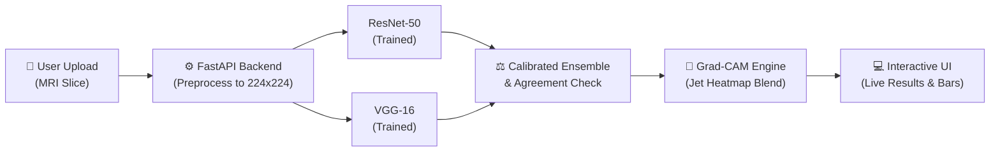

<div align="center">

# 🧠 Alzheimer MRI Classifier
### Dual-Model Deep Learning Web Application for Alzheimer's Detection

[](https://www.python.org/)
[](https://pytorch.org/)
[](https://fastapi.tiangolo.com/)
[](https://react.dev/)
[](https://tailwindcss.com/)
[](https://data.mendeley.com/datasets/3r8hw8wmmk/1)
[](https://github.com/afrojkhan6033)

[](https://github.com/afrojkhan6033/Alzheimer-MRI-Classifier/stargazers)
[](https://github.com/afrojkhan6033/Alzheimer-MRI-Classifier/network/members)
[](https://github.com/afrojkhan6033)

<p align="center">
  A clean, modern medical imaging web application for classifying Alzheimer's disease stages from brain MRI scans using independently trained <b>ResNet-50</b> and <b>VGG-16</b> models with <b>Grad-CAM visual heatmaps</b>.
</p>

</div>

---

## 📸 Screenshots

<div align="center">

### 1. Multi-Model Prediction & Agreement Dashboard


<br/><br/>

### 2. Grad-CAM Visual Attention Heatmaps


</div>

---

## ⚡ Key Highlights

* **🧠 Dual-Model Architecture**: Simultaneous inference across **ResNet-50** (25.6M params) and **VGG-16** (134.3M params) trained on 4 Alzheimer's stages.
* **🎯 Weighted Ensemble**: Combines outputs using validation-F1 weights with dynamic **agreement detection** and disagreement warnings.
* **🔬 Grad-CAM Attention Heatmaps**: Overlays visual heatmaps onto the MRI slice to highlight the brain regions the models focus on.
* **🛡️ Temperature Calibrated**: Softmax probabilities scaled with validation-learned temperatures to deliver realistic confidence scores.
* **🔒 Privacy-First**: 100% in-memory processing — no uploaded scans are stored on disk or sent externally.
* **⚡ Modern Tech Stack**: High-speed **FastAPI** backend + responsive dark-mode **React 18 & Tailwind CSS** frontend.

---

## 🔄 How It Works



---

## 🚀 Quick Start

### 1. Clone the Repository
```bash
git clone https://github.com/afrojkhan6033/Alzheimer-MRI-Classifier.git
cd Alzheimer-MRI-Classifier
```

### 2. Run the Backend
```bash
cd backend
pip install -r requirements.txt
python -m uvicorn main:app --host 127.0.0.1 --port 8000
```
> The API will start at **http://127.0.0.1:8000** (auto-detects CUDA GPU or CPU fallback).

### 3. Run the Frontend
```bash
cd frontend
npm install
npm run dev
```
> Open **http://localhost:5173** in your browser.

### 4. Test Instantly with Sample Scans
Don't have an MRI dataset downloaded? Use the ready-to-test MRI slices included in [`sample_images/`](sample_images/):
* `sample_images/non_demented_sample.jpg`
* `sample_images/very_mild_demented_sample.jpg`
* `sample_images/mild_demented_sample.jpg`
* `sample_images/moderate_demented_sample.jpg`

Simply drag and drop any sample scan onto the dashboard and click **Analyze MRI Scan**!

---

## 📊 Dataset & Classification Stages

* **Dataset Source**: [Mendeley Data — Alzheimer's Dataset (4 classes)](https://data.mendeley.com/datasets/3r8hw8wmmk/1)
* **Classes Detected**:
  1. `Non_Demented` — Healthy cognitive baseline
  2. `Very_Mild_Demented` — Early-stage cognitive decline
  3. `Mild_Demented` — Noticeable cerebral atrophy
  4. `Moderate_Demented` — Advanced neurodegeneration

---

## 📂 Project Structure

```
Alzheimer-MRI-Classifier/
├── assets/screenshots/             # Application UI screenshots
├── backend/
│   ├── main.py                     # FastAPI REST API & routes
│   ├── models.py                   # Model loaders & inference manager
│   ├── preprocessing.py            # MRI transform pipeline
│   ├── gradcam.py                  # PyTorch backward-hook Grad-CAM engine
│   └── requirements.txt            # Python dependencies
├── frontend/
│   ├── src/                        # React components & UI layout
│   ├── package.json
│   └── vite.config.js
├── runs/
│   ├── calibration.json            # Calibrated temperature scaling parameters
│   ├── splits.csv                  # Reproducible dataset train/val/test split
│   ├── resnet50/                   # ResNet-50 metrics & plots (.gitkeep)
│   └── vgg16/                      # VGG-16 metrics & plots (.gitkeep)
├── sample_images/                  # Curated MRI slices for instant UI testing
├── resnet50.py                     # ResNet-50 training script
├── vgg16.py                        # VGG-16 training script
└── README.md
```

---

## 🌟 Support & Community

If this project helps you, sparks an idea, or saves you development time, show your support:

<div align="center">

| ⭐️ **Star this Repo** | 👤 **Follow Developer** | 🍴 **Fork Project** |
|:---:|:---:|:---:|
| Leave a star if you find this project valuable! | Follow for more Deep Learning & AI healthcare tools | Feel free to fork and build upon this work |
| [](https://github.com/afrojkhan6033/Alzheimer-MRI-Classifier/stargazers) | [](https://github.com/afrojkhan6033) | [](https://github.com/afrojkhan6033/Alzheimer-MRI-Classifier/fork) |

<br/>

> 💡 **Contributions, feedback, and feature suggestions are always welcome!**  
> Found a bug or have an idea? Open an **[Issue](https://github.com/afrojkhan6033/Alzheimer-MRI-Classifier/issues)** or submit a **[Pull Request](https://github.com/afrojkhan6033/Alzheimer-MRI-Classifier/pulls)**.

</div>

---

## 👨‍💻 Developer & Author

<div align="center">


### **Afroj Khan**
[](https://github.com/afrojkhan6033)
[](https://github.com/afrojkhan6033)

*Machine Learning & Full-Stack Developer*  
*Independently implemented, trained, and integrated the ResNet-50 & VGG-16 neural pipelines, Grad-CAM visual heatmaps, FastAPI backend, and React web interface.*

</div>

---

## ⚠️ Disclaimer

*This project is built strictly for **educational and research purposes**. It is not a certified medical device and should not be used as a substitute for professional clinical diagnosis.*
