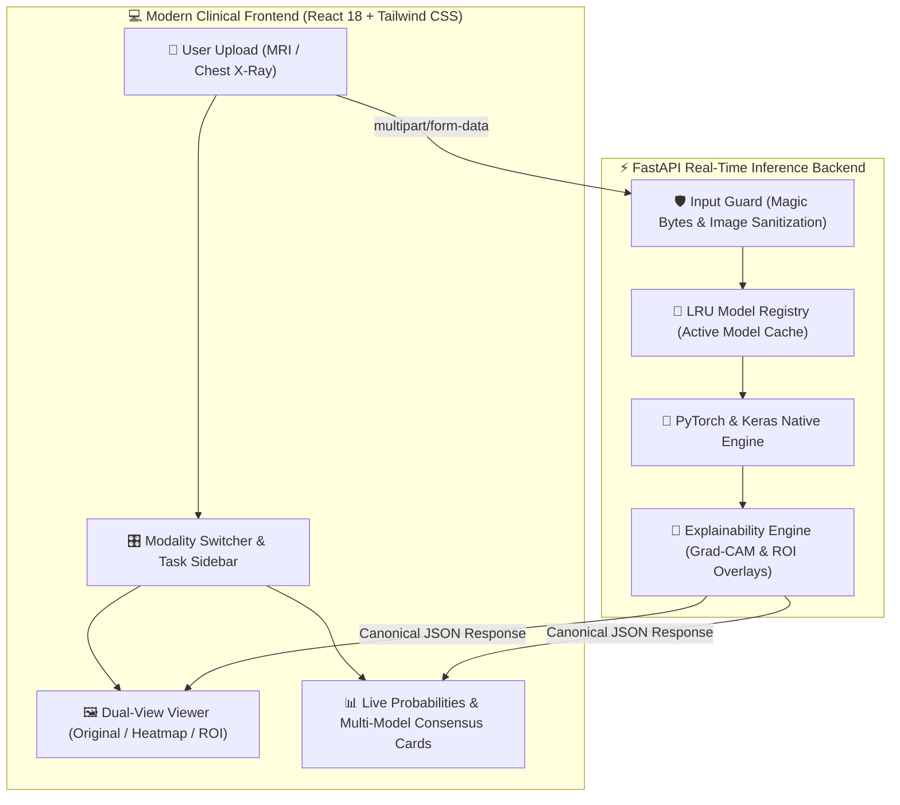

<div align="center">

# 🩺 MedVisionAi
### ⚡ The Unified Next-Generation Clinical Medical Imaging AI Platform ⚡

[](https://www.python.org/)
[](https://fastapi.tiangolo.com/)
[](https://pytorch.org/)
[](https://react.dev/)
[](https://tailwindcss.com/)
[](https://developer.nvidia.com/cuda-zone)
[](https://github.com/afrojkhan6033)

[](https://github.com/afrojkhan6033/MedVisionAi/stargazers)
[](https://github.com/afrojkhan6033/MedVisionAi/network/members)
[](https://github.com/afrojkhan6033)

<br/>

<p align="center">
  <b>MedVisionAi</b> is an all-in-one clinical diagnostic workstation integrating <b>4 advanced deep learning model ensembles</b> into a unified, high-performance interface. Featuring multi-model consensus validation, real-time Grad-CAM heatmaps, automated ROI extraction, and instantaneous inference.
</p>

</div>

---

## 🌟 Key Highlights & Superpowers

* 🧠 **4 Diagnostic Engines in 1**: Seamlessly analyze Brain MRIs and Chest Scans across four major pathologies without switching tools.
* ⚖️ **Dynamic Multi-Model Ensembles**: Combines predictions from diverse architectures (ResNet-50, VGG-16, DenseNet-121, Xception) with automated consensus tracking.
* 🔥 **Grad-CAM Visual Explainability**: Real-time jet color-mapped attention heatmaps pinpoint the exact anatomical regions influencing the diagnosis.
* 🎯 **Automated Contour-Based ROI**: Intelligent morphological contour extraction isolates critical areas for high-precision lesion classification.
* ⚡ **Ultra-Fast In-Memory Inference**: Zero disk writes for uploads; full GPU acceleration via CUDA with sub-second inference speeds.
* 🛡️ **Thread-Safe LRU Model Registry**: Intelligently manages GPU/CPU memory with auto-eviction and hot-reloading.
* 🎨 **Clinical Dark-Mode Workspace**: Sleek, distraction-free 3-zone UI built with React 18, Vite, and Tailwind CSS.

---

## 🔬 Supported Clinical Diagnostics

| Diagnostic Suite | Modality | Architectures | Target Classes | Explainability (XAI) | Status |
| :--- | :---: | :---: | :--- | :---: | :---: |
| 🧠 **Alzheimer's Disease Detection** | **Brain MRI** | ResNet-50 + VGG-16 *(Weighted Ensemble)* | `Non_Demented`, `Very_Mild_Demented`, `Mild_Demented`, `Moderate_Demented` | 🔬 **Grad-CAM Attention** | 🟢 **Ready** |
| 🧬 **Brain Tumor Screening** | **Brain MRI** | Custom CNN *(Contour-Cropped)* | `No Tumor`, `Tumor` | 🎯 **ROI Bounding Box** | 🟢 **Ready** |
| 🫁 **Pneumonia Screening** | **Chest Scan** | DenseNet-121 + VGG-16 *(Calibrated)* | `Normal`, `Pneumonia` | 🔬 **Grad-CAM Attention** | 🟢 **Ready** |
| 🦠 **COVID-19 Diagnostics** | **Chest Scan** | ResNet-50 + VGG-16 + Xception | `COVID-19`, `NORMAL` | 📊 **Multi-Vote Consensus** | 🟢 **Ready** |

---

## 🏗️ System Architecture



---

## 🚀 Quick Start Guide

### 1️⃣ Clone the Repository
```bash
git clone https://github.com/afrojkhan6033/MedVisionAi.git
cd MedVisionAi
```

### 2️⃣ Launch the Backend (FastAPI)
```bash
# Install dependencies
pip install -r backend/requirements.txt

# Start the high-performance inference server
python -m backend.main
```
> 🌐 **Backend API:** `http://localhost:8000`  
> 📑 **Swagger API Docs:** `http://localhost:8000/docs`

### 3️⃣ Launch the Clinical Frontend (React + Vite)
```bash
cd frontend

# Install packages
npm install

# Start Vite dev server
npm run dev
```
> 🩺 **Clinical Workspace UI:** `http://localhost:5173`

---

## 📁 Repository Structure

```text
MedVisionAi/
├── 📂 artifacts/               # 📦 Model manifests, calibration metadata & weights
│   ├── 🧠 alzheimer/          # ResNet-50 + VGG-16 PyTorch weights
│   ├── 🧬 brain_tumor/        # Custom CNN model weights
│   ├── 🦠 covid/              # ResNet-50, VGG-16 & Xception weights
│   └── 🫁 pneumonia/          # DenseNet-121 + VGG-16 PyTorch weights
├── 📂 backend/                 # ⚡ High-speed FastAPI inference backend
│   ├── 🚀 main.py             # REST API application, lifespan & endpoints
│   ├── ⚙️ config.py           # Paths, CORS settings & limits
│   ├── 🛡️ input_guard.py      # Image validation & in-memory decoding
│   ├── 🧠 registry.py         # Thread-safe LRU Model Registry (4 slots)
│   ├── 📋 schemas.py          # Pydantic v2 canonical schemas
│   └── 📂 pipelines/          # 🔬 Pipeline adapters for all diseases
│       ├── base.py            # Abstract BasePipeline & Grad-CAM engine
│       ├── alzheimer.py       # Alzheimer's dual-model pipeline
│       ├── brain_tumor.py     # Brain tumor contour crop & classifier
│       ├── pneumonia.py       # Pneumonia DenseNet & VGG adapter
│       └── covid.py           # COVID-19 majority-vote ensemble
├── 📂 frontend/                # 💻 React 18 + Tailwind CSS clinical dashboard
│   ├── 📂 src/
│   │   ├── 📱 App.tsx         # 3-Zone Clinical Workspace layout
│   │   ├── 📂 components/     # TopBar, TaskSidebar, ScanViewer, ProbBars, etc.
│   │   ├── 📂 hooks/          # useDiagnosis reactive state machine
│   │   └── 📂 api/            # Typed fetch client & schemas
│   └── ⚡ vite.config.ts      # Fast Vite bundler configuration
└── 📜 README.md
```

---

## 👨‍💻 Developer & Author

<div align="center">


### **Afroj Khan**
[](https://github.com/afrojkhan6033)
[](https://github.com/afrojkhan6033)

*Machine Learning & Full-Stack AI Engineer*  
*Sole author and architect of MedVisionAi — independently developed the 4 deep learning model pipelines, Grad-CAM attention visualizers, FastAPI backend, and React clinical workspace.*

<br/>

| ⭐️ **Star this Project** | 👤 **Follow Developer** | 🍴 **Fork Repository** |
|:---:|:---:|:---:|
| If you find this platform valuable, drop a star! | Follow to get updates on upcoming AI healthcare systems | Feel free to fork and build upon this platform |
| [](https://github.com/afrojkhan6033/MedVisionAi/stargazers) | [](https://github.com/afrojkhan6033) | [](https://github.com/afrojkhan6033/MedVisionAi/fork) |

</div>

---

## ⚠️ Clinical Disclaimer

> **Research & Educational Purposes Only.** MedVisionAi is designed exclusively for academic and research evaluation. It is not an FDA/CE-cleared medical device. The AI predictions, probabilities, and heatmaps produced by these models must not be used as a replacement for professional clinical judgment, diagnosis, or treatment planning. Always consult licensed medical professionals.
